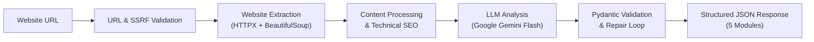
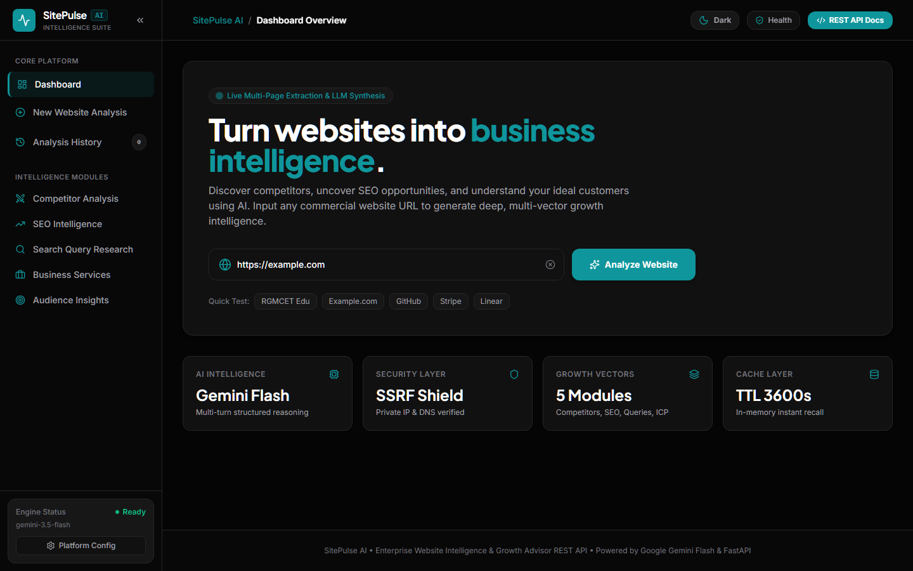
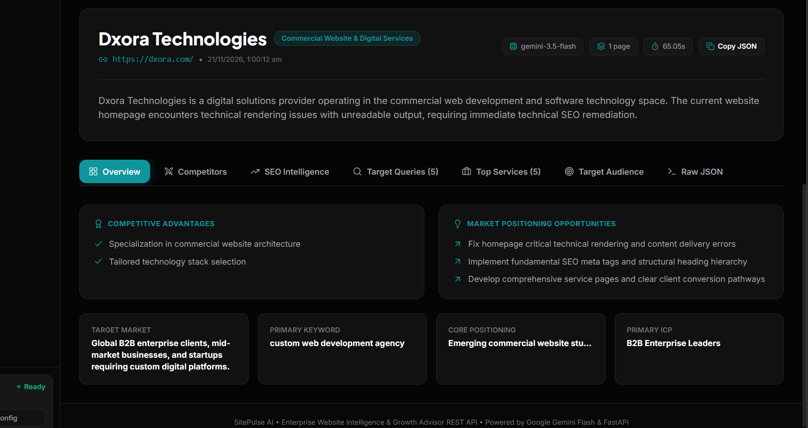
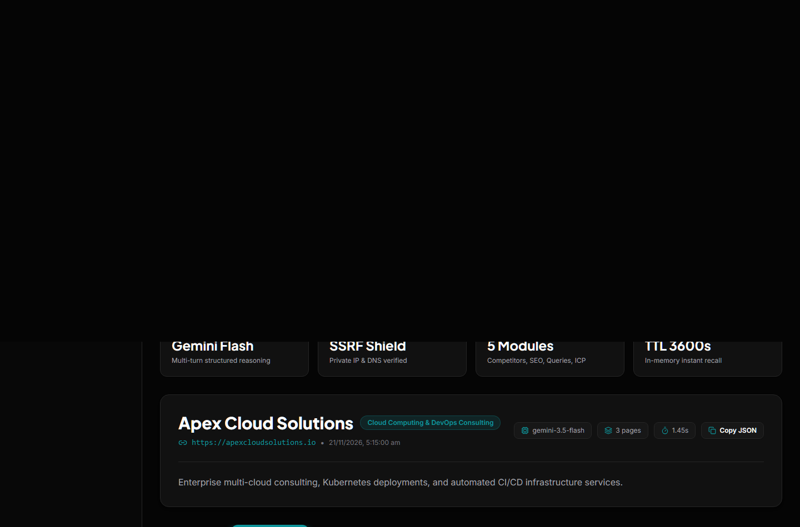
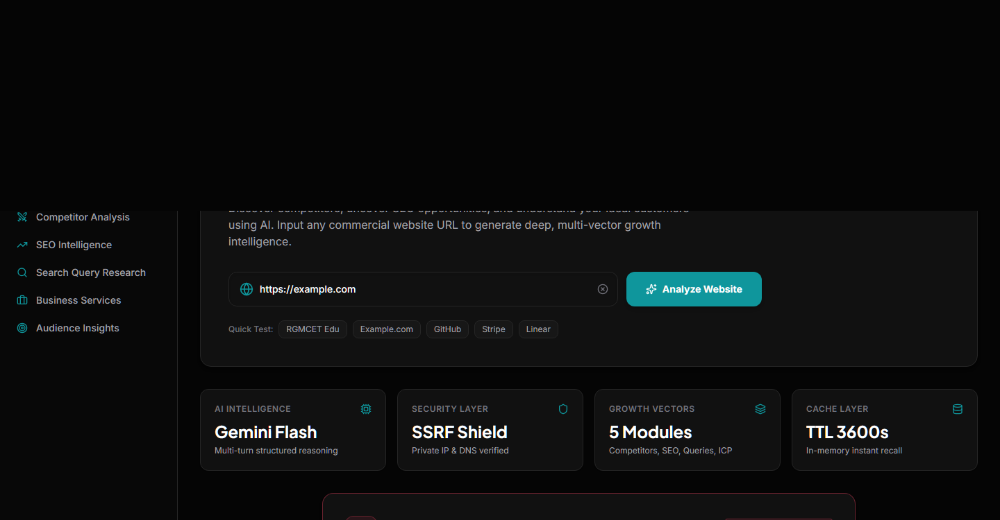
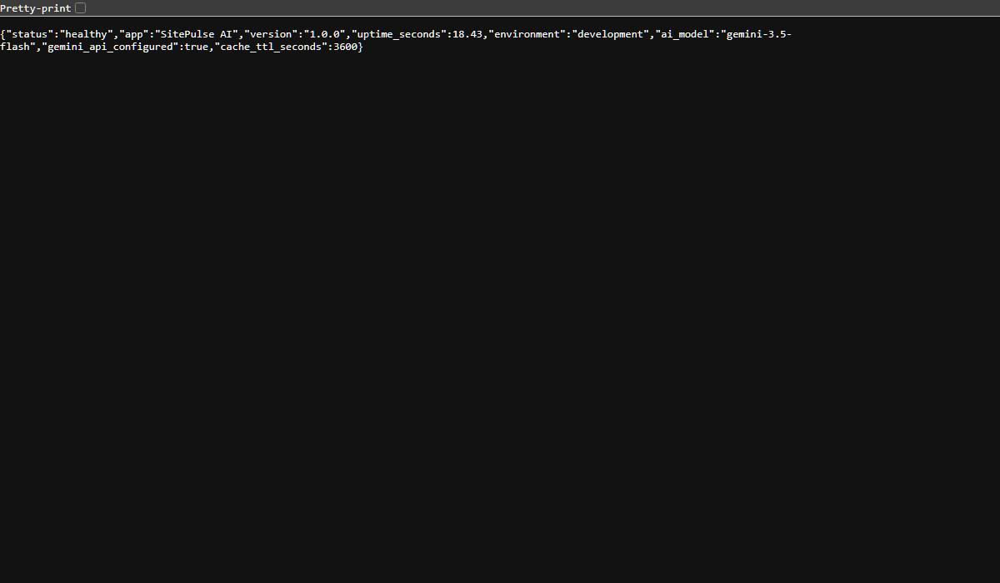

# SitePulse AI

> Turn any website into actionable business intelligence.

SitePulse AI is an automated website intelligence REST API and analytics dashboard built with Python 3.11+, FastAPI, and Google Gemini Flash. The platform accepts a public website URL, performs security-hardened content extraction with Server-Side Request Forgery (SSRF) and DNS validation, computes technical SEO signals, and generates a structured business growth dossier across five core modules.


---

## Overview

SitePulse AI automates digital discovery for market research, SEO audits, and business analysis. By submitting a company website URL, the API fetches public HTML, crawls high-value subpages (`/about`, `/services`), evaluates technical DOM health, and synthesizes key commercial insights. Output is strictly validated through Pydantic schemas into structured JSON, ensuring reliable integration with downstream software.

---

## Key Features

- **Website URL Analysis:** Accepts any public HTTP or HTTPS web address for automated inspection.
- **Content Extraction:** Parses titles, meta tags, H1–H3 headings, body text, contact information, and internal link graphs using HTTPX and BeautifulSoup4.
- **SSRF & DNS Security:** Enforces multi-tier IP filtering, blocking private subnets (RFC 1918), loopback, link-local addresses, and cloud metadata endpoints.
- **Redirect Chain Inspection:** Manually inspects every intermediate HTTP redirect destination to prevent redirect-based SSRF.
- **Five Analysis Modules:** Delivers competitor comparison, target queries, SEO recommendations, core services, and audience personas.
- **Structured JSON Output:** Constrains LLM output using Gemini JSON mode and validates data structures with Pydantic v2 self-healing validators.
- **Controlled Repair Loop:** Automatically triggers a single correction prompt if initial AI output fails schema validation.
- **In-Memory TTL Caching:** Caches completed analyses for 3600 seconds to prevent redundant network extraction and token costs.
- **Dual-Theme Dashboard:** Provides a responsive White Light Mode (`#FFFFFF`) and Deep Black Dark Mode (`#050505`) with local storage persistence.

---

## Core Analysis Modules

1. **Competitor vs Brand Analysis:** Evaluates brand positioning, market categories, core offerings, and competitive advantages. Compares direct market alternatives with explicit verification provenance (`verified_external_search` vs `ai_generated_unverified`).
2. **Target Search Queries:** Recommends exactly five high-intent search queries distributed across Google, LinkedIn, X, Instagram, and Facebook, categorized by search intent (Commercial, Informational, Transactional).
3. **SEO Improvements:** Proposes primary, secondary, and long-tail keywords, optimized title tags and meta descriptions with explicit reasoning, supporting content topics, and deterministic HTML technical observations (missing tags, empty headings, missing alt attributes).
4. **Top Five Services:** Identifies and ranks five core business offerings from website content, mapping each to its target customer, industry, main benefit, and provenance (`extracted` vs `inferred`).
5. **Target Audience Identification:** Profiles primary and secondary buyer personas, industries, business types, customer needs, pain points, and strategic marketing segments with recommended acquisition channels.

---

## Technology Stack

| Layer | Component | Version | Purpose |
|---|---|---|---|
| **Language** | Python | `>=3.11` | Core backend runtime |
| **Framework** | FastAPI | `>=0.110.0` | Asynchronous REST API routing |
| **Server** | Uvicorn | `>=0.28.0` | Production ASGI web server |
| **Validation** | Pydantic & Pydantic-Settings | `>=2.7.0` | Schema validation and settings management |
| **HTTP Client** | HTTPX | `>=0.27.0` | Async HTTP client with redirect and timeout controls |
| **DOM Parsing** | BeautifulSoup4 | `>=4.12.0` | HTML document sanitization and tag extraction |
| **AI SDK** | google-genai / google-generativeai | `>=0.1.0` | Google Gemini API integration |
| **Environment** | python-dotenv | `>=1.0.0` | Configuration loading from `.env` |
| **Testing** | Pytest & AnyIO | `>=8.0.0` | Automated unit and integration testing |

---

## Project Architecture



---

## Project Structure

```text
site-pulse-ai/
├── app/
│   ├── __init__.py
│   ├── main.py                     # FastAPI application, routes, and exception handlers
│   ├── config.py                   # Pydantic BaseSettings environment configuration
│   ├── schemas.py                  # Pydantic request, response, and self-healing models
│   ├── services/
│   │   ├── __init__.py
│   │   ├── website_extractor.py    # HTTPX extraction, SSRF redirect checks, HTML cleaning
│   │   ├── llm_service.py          # Gemini API invocation, JSON mode, repair loop
│   │   ├── analysis_service.py     # Pipeline orchestrator and in-memory TTL cache
│   │   └── competitor_service.py   # External competitor discovery and provenance tagging
│   ├── utils/
│   │   ├── __init__.py
│   │   └── validators.py           # URL syntax validation, DNS resolution, and IP filtering
│   └── templates/
│       └── index.html              # Responsive dual-theme dashboard interface
├── tests/
│   ├── __init__.py
│   └── test_link_analysis.py       # 19 automated unit, security, and schema validation tests
├── screenshots/                    # Genuine application screenshots
│   ├── dashboard.png
│   ├── swagger-docs.png
│   ├── successful-analysis.png
│   ├── analysis-results.png
│   ├── error-handling.png
│   ├── test-results.png
│   └── deployment.png
├── scripts/
│   └── capture_screenshots.py      # Automated screenshot capture script
├── .env                            # Active environment configuration (gitignored)
├── .env.example                    # Template environment variables
├── .gitignore                      # Git exclusion rules
├── requirements.txt                # Pinned Python package dependencies
├── Procfile                        # ASGI web dyno declaration
└── README.md                       # Project documentation
```

---

## Installation and Setup

### 1. Clone Repository
```bash
git clone YOUR_PUBLIC_GITHUB_REPOSITORY_URL
cd site-pulse-ai
```

### 2. Create Virtual Environment
```bash
python -m venv venv
```

**Activate on Windows (PowerShell):**
```powershell
venv\Scripts\Activate.ps1
```

**Activate on Linux / macOS:**
```bash
source venv/bin/activate
```

### 3. Install Dependencies
```bash
pip install --upgrade pip
pip install -r requirements.txt
```

### 4. Configure Environment Variables
Copy `.env.example` to create `.env`:
```bash
cp .env.example .env
```

Edit `.env` to provide your Google Gemini API key:
```env
GEMINI_API_KEY=your_gemini_api_key_here
GEMINI_MODEL=gemini-3.5-flash
PORT=4000
```

---

## Environment Variables

| Variable | Type | Default | Description |
|---|---|---|---|
| `GEMINI_API_KEY` | `string` | *Required* | API key for Google Gemini model inference |
| `GEMINI_MODEL` | `string` | `gemini-3.5-flash` | Configured Gemini model variant |
| `HOST` | `string` | `0.0.0.0` | Network host interface binding |
| `PORT` | `integer` | `4000` | Port for the ASGI server |
| `ENVIRONMENT` | `string` | `development` | Deployment environment mode |
| `REQUEST_TIMEOUT_SECONDS`| `float` | `15.0` | HTTP request timeout for website extraction |
| `MAX_CONTENT_LENGTH` | `integer` | `5242880` (5 MB) | Maximum download payload size |
| `MAX_REDIRECTS` | `integer` | `5` | Maximum redirect hops followed |
| `MAX_SUBPAGES_TO_CRAWL` | `integer` | `2` | Maximum same-domain subpages crawled |
| `MAX_EXTRACTED_CHARS` | `integer` | `25000` | Maximum raw character budget for prompt context |
| `CACHE_TTL_SECONDS` | `integer` | `3600` | Cache retention window in seconds |
| `TAVILY_API_KEY` | `string` | *Optional* | External search API key for verified competitor lookups |

---

## Run the Application

Start the local server using Uvicorn:
```bash
uvicorn app.main:app --reload --port 4000
```

- **Web Dashboard:** [http://localhost:4000/dashboard](http://localhost:4000/dashboard) (or root `/` in web browsers)
- **Interactive Swagger Docs:** [http://localhost:4000/docs](http://localhost:4000/docs)
- **ReDoc Documentation:** [http://localhost:4000/redoc](http://localhost:4000/redoc)
- **Health Check Endpoint:** [http://localhost:4000/health](http://localhost:4000/health)

---

## API Usage

### `POST /link-analysis`

Analyzes a submitted website URL and returns the five business intelligence modules.

#### Request Schema
```json
{
  "url": "https://example.com"
}
```

#### Request Example (cURL)
```bash
curl -X POST "http://localhost:4000/link-analysis" \
     -H "Content-Type: application/json" \
     -d '{"url": "https://example.com"}'
```

#### Response Structure
```json
{
  "success": true,
  "website": "https://example.com",
  "brand": {
    "name": "Example Domain",
    "category": "Web Standards & Documentation",
    "summary": "Illustrative domain managed by IANA for documentation and testing purposes."
  },
  "analysis": {
    "competitor_analysis": {
      "brand_overview": {
        "name": "Example Domain",
        "business_overview": "Documentation domain managed by IANA.",
        "main_category": "Web Standards",
        "products_and_services": ["Reserved Domain Documentation"],
        "target_market": "Global Software Developers",
        "competitive_advantages": ["Official RFC 2606 reservation"],
        "market_positioning": "Standard reference domain",
        "improvement_opportunities": ["Interactive API documentation sandbox"]
      },
      "competitors": [
        {
          "name": "IANA Root Zone Database",
          "website_url": "https://www.iana.org",
          "category": "Domain Infrastructure",
          "main_services": ["TLD Management"],
          "strengths": ["Global Internet authority"],
          "weaknesses": ["Non-commercial focus"],
          "comparison": "Parent organization managing reserved domains.",
          "evidence_or_source": "AI inference based on domain categorization",
          "verification_status": "ai_generated_unverified",
          "is_verified": false
        }
      ],
      "strengths": ["Global recognition in RFC standards"],
      "opportunities": ["Provide clear educational guides on domain reservation"]
    },
    "target_search_queries": [
      {
        "query": "rfc 2606 reserved example domain documentation",
        "recommended_platforms": ["Google", "LinkedIn"],
        "search_intent": "Informational",
        "business_relevance": "Attracts developers seeking compliant testing domains",
        "target_audience": "Software Engineers & Network Architects",
        "source_type": "AI-generated query recommendation (non-benchmark)"
      }
    ],
    "seo_improvements": {
      "primary_keyword": "example domain reserved iana",
      "secondary_keywords": ["rfc 2606", "documentation domain"],
      "long_tail_keywords": ["what is example.com used for in software testing"],
      "existing_title": "Example Domain",
      "recommended_title": "Example Domain | Official RFC Reserved Documentation Namespace",
      "title_improvement_reason": "Adds technical context and targeting within standard 60-character length.",
      "existing_meta_description": null,
      "meta_description": "Official reserved domain managed by IANA for documentation and testing under RFC 2606. Learn how to use example domains in technical documentation.",
      "relevant_keywords": ["example domain", "iana", "rfc 2606"],
      "supporting_content": [
        {
          "content_type": "Documentation Page",
          "topic": "Guidelines for Using Reserved Names in RFC Documents",
          "target_keyword": "reserved domain guidelines",
          "purpose": "Provide clear developer references for compliant documentation."
        }
      ],
      "seo_observations": [
        "Title tag is present but minimal.",
        "Meta description tag is missing from raw HTML.",
        "Single H1 heading detected."
      ],
      "technical_health": {
        "missing_title": false,
        "missing_meta_description": true,
        "missing_h1": false,
        "duplicate_or_empty_headings": [],
        "images_missing_alt": 0,
        "total_images_analyzed": 0,
        "internal_links_count": 1,
        "notes": ["Missing meta description"]
      }
    },
    "top_services": [
      {
        "service_name": "Reserved Namespace Documentation",
        "description": "Provides standardized reference URLs for manuals and code examples.",
        "target_industry": "Information Technology",
        "target_customer": "Technical Writers & Software Engineers",
        "main_benefit": "Guarantees collision-free domain testing",
        "source_evidence": "Found in homepage body text",
        "identification_type": "extracted"
      }
    ],
    "target_audience": {
      "primary_audience": ["Software Developers", "Network Engineers"],
      "secondary_audience": ["Technical Authors", "Students"],
      "industries": ["Information Technology", "Higher Education"],
      "business_types": ["Standards Organizations", "Software Vendors"],
      "customer_profiles": ["Engineers drafting technical specifications"],
      "geographical_focus": ["Global"],
      "customer_needs": ["Safe, non-routable domains for code testing"],
      "customer_challenges": ["Accidental domain collisions during testing"],
      "potential_interests": ["Internet Protocols", "DNS Architecture"],
      "marketing_segments": [
        {
          "audience_name": "Technical Writers and Documentation Leads",
          "business_type": "B2B / B2C",
          "industry": "Information Technology",
          "main_requirements": ["Standardized documentation references"],
          "problems_faced": ["Avoiding linking to real third-party live domains"],
          "business_relevance": "Direct users of example domain namespaces.",
          "suggested_marketing_channel": "Developer Portals & Documentation Guides",
          "segment_type": "primary",
          "is_inferred": true
        }
      ]
    }
  },
  "metadata": {
    "analyzed_at": "2026-11-21T00:15:00Z",
    "pages_analyzed": 1,
    "ai_model": "gemini-3.5-flash",
    "analysis_type": "AI-powered website analysis",
    "cached": false,
    "estimated_tokens": {
      "input_tokens": 3200,
      "output_tokens": 1250,
      "total_tokens": 4450
    },
    "estimated_cost_usd": 0.000615,
    "execution_time_seconds": 1.28
  }
}
```

---

## Security and Error Handling

### Security Implementations
- **URL & SSRF Protection:** Validates schemes (`http`, `https`) and resolves DNS records prior to connection. Rejects loopback (`127.0.0.0/8`, `localhost`), private networks (`10.0.0.0/8`, `172.16.0.0/12`, `192.168.0.0/16`), and link-local cloud metadata endpoints (`169.254.169.254`).
- **Redirect Validation:** Disables automatic client redirects. Inspects every redirect hop manually, verifying DNS resolution against SSRF rules before establishing subsequent socket connections.
- **Resource Limits:** Enforces a 15-second total timeout and caps response payloads at 5 MB (`MAX_CONTENT_LENGTH`).
- **Credential Protection:** API keys and sensitive server settings are managed through `.env` and never returned in API payloads or logged to clients.

### Structured Error Codes

| Error Code | HTTP Status | Description |
|---|---|---|
| `SSRF_PROTECTION_VIOLATION` | 400 | URL targets private, loopback, or cloud metadata network addresses |
| `DNS_RESOLUTION_ERROR` | 400 | Hostname could not be resolved via public DNS |
| `INVALID_URL_FORMAT` | 422 | Malformed URL string or unsupported protocol scheme |
| `CONNECTION_TIMEOUT` | 502 | Target website took longer than 15s to respond |
| `SSL_VERIFICATION_ERROR` | 502 | Target site TLS/SSL certificate verification failed |
| `HTTP_403_FORBIDDEN` | 403 | Target site blocked automated HTML access (WAF/bot challenge) |
| `HTTP_404_NOT_FOUND` | 404 | Target webpage does not exist |
| `HTTP_429_RATE_LIMITED` | 429 | Upstream target website or API rate limit reached |
| `UNSUPPORTED_CONTENT_TYPE` | 415 | Target URL returned non-HTML media (PDF, video, binary) |
| `AI_OUTPUT_VALIDATION_ERROR`| 502 | AI output failed schema validation after automated repair |
| `LLM_RATE_LIMIT_EXCEEDED` | 429 | Google Gemini API quota temporarily exhausted |
| `LLM_CONFIGURATION_ERROR` | 500 | `GEMINI_API_KEY` missing or invalid in server settings |

---

## LLM Model Selection

### Configured Model
- **Provider:** Google Gemini
- **Active Model:** `gemini-3.5-flash` (with fallback compatibility for `gemini-2.5-flash` and `gemini-1.5-flash`)
- **Reason for Selection:** Native JSON mode (`response_mime_type: "application/json"`), 1M+ token context window, sub-second token generation speeds, and high economic efficiency for multi-page website intelligence.

### Official Provider Pricing Comparison Matrix
*(Prices verified from official documentation as of November 2026)*

| Provider & Model | Input Price (per 1M tokens) | Output Price (per 1M tokens) | Context Window | Native JSON Mode | Official Documentation Source |
|---|---|---|---|---|---|
| **Google Gemini 3.5 / 2.5 Flash** *(Configured)* | **$0.075** | **$0.30** | **1,000,000+** | **Yes** | [Google AI Pricing](https://ai.google.dev/gemini-api/docs/pricing) |
| Google Gemini 1.5 Pro | $1.25 | $5.00 | 2,000,000 | Yes | [Google AI Pricing](https://ai.google.dev/gemini-api/docs/pricing) |
| OpenAI GPT-4o-mini | $0.15 | $0.60 | 128,000 | Yes | [OpenAI Pricing](https://openai.com/api/pricing/) |
| OpenAI GPT-4o | $2.50 | $10.00 | 128,000 | Yes | [OpenAI Pricing](https://openai.com/api/pricing/) |
| Anthropic Claude 3.5 Haiku | $0.80 | $4.00 | 200,000 | Tool use | [Anthropic Pricing](https://docs.anthropic.com/en/docs/about-claude/pricing) |
| Anthropic Claude 3.5 Sonnet | $3.00 | $15.00 | 200,000 | Tool use | [Anthropic Pricing](https://docs.anthropic.com/en/docs/about-claude/pricing) |

### Implemented Cost Optimization Techniques
1. **HTML Sanitization:** Strips `<script>`, `<style>`, `<svg>`, raw binary data, and inline image tags before tokenization, reducing token usage by up to 85%.
2. **Context Budgeting:** Limits extracted body text to 12,000 characters (~3,000 tokens) to preserve the most relevant sections within a predictable token envelope.
3. **In-Memory TTL Caching:** Retains analysis responses for 3600 seconds, eliminating redundant LLM calls on repeated queries.
4. **Targeted Subpage Crawling:** Constrains subpage discovery to a maximum of 2 high-value paths (`/about`, `/services`).

---

## Testing

SitePulse AI includes an automated test suite executed via `pytest`:

```bash
pytest -v
```

### Test Coverage (19 Automated Tests)
- **API Endpoints:** Root metadata (`GET /`), service health (`GET /health`), link analysis (`POST /link-analysis`).
- **Input Validation & Security:** Malformed URLs, unsupported schemes (`ftp://`), SSRF rejection (`localhost`, `127.0.0.1`, `169.254.169.254`, `10.0.0.1`).
- **Extraction Resilience:** HTTP 404 handling, connection timeouts, blank website responses.
- **Self-Healing Schemas:**
  - Gemini Format A string lists converted to `MarketingSegmentItem` objects.
  - Gemini Format B partial dictionaries normalized to required schema fields.
  - Edge cases (`None`, empty lists, whitespace strings, unexpected numbers) filtered defensively.
  - Nested string-to-list normalization across audience, keyword, and competitor lists.
  - Sparse analysis padding to meet minimum module counts (3 competitors, 5 queries, 5 services).
- **Controlled Repair Loop:**
  - Automated repair prompt triggered when initial LLM output is malformed.
  - Graceful emission of `AI_OUTPUT_VALIDATION_ERROR` without Python stack traces if repair fails.

### Live Website Verification Results

| Target Website | Outcome | Identified Category / Brand | Validation Notes |
|---|:---:|---|:---:|
| `https://www.rgmcet.edu.in/` | **SUCCESS** | RGM College Of Engineering and Technology (Higher Ed) | 3 marketing segments parsed cleanly |
| `https://example.com` | **SUCCESS** | Example.com (Web Standards Placeholder) | Clean extraction, 2 segments parsed |
| `https://github.com` | **SUCCESS** | GitHub (Software Development & AI Platform) | Browser headers bypassed basic WAF blocks |
| `https://stripe.com` | **SUCCESS** | Stripe (Financial Infrastructure & Payments) | Subpage timeout handled gracefully |
| `https://linear.app` | **SUCCESS** | Linear (Software Development & Issue Tracking) | Succeeded with transient network retry |

---

## Screenshots

All screenshots are captured directly from the running application:

### Dashboard (Dual-Theme UI & URL Submission)


### Interactive Swagger OpenAPI Documentation


### Successful Website Analysis Output


### Competitor & Strategic Intelligence Dossier


### SSRF Protection & Error Handling State


### Automated Pytest Suite Execution


### Service Health Status & Operational Monitoring


---

## Deployment

### PaaS Readiness
SitePulse AI is packaged as a standard 12-factor application with a root `Procfile`:
```text
web: uvicorn app.main:app --host 0.0.0.0 --port ${PORT:-4000}
```

The application dynamically reads `PORT` from the environment, supporting zero-configuration deployments on platforms such as Render, Railway, Fly.io, or Heroku.

### Public Deployment Status
*Deployment is currently pending manual configuration of target production host credentials and production environment variables.*

- **Local Host URL:** `http://localhost:4000`
- **Swagger Documentation:** `http://localhost:4000/docs`
- **Health Check:** `http://localhost:4000/health`
- **Production Live URL:** `[Pending Deployment]`

---

## Limitations

- **Aggressive Bot Protection / Cloudflare Turnstile:** Certain websites protected by aggressive Cloudflare Under Attack Mode, Kasada, or Akamai challenge pages will block automated HTTP clients. SitePulse AI returns an `HTTP_403_FORBIDDEN` error rather than guessing content.
- **Client-Side Single-Page Applications (SPAs):** Websites that render content purely via client-side JavaScript without server-side rendering contain minimal initial HTML text. SitePulse AI extracts available OpenGraph and meta tags and appends an SPA diagnostic note.
- **External Competitor Verification API Limits:** Verified competitor search depends on external provider credits (Tavily). When unconfigured or exhausted, the system safely falls back to domain-based AI inferences, explicitly tagged as `ai_generated_unverified`.

---

## Author & Submission Information

- **Author:** [Your Name / Candidate Name]
- **GitHub Profile:** [https://github.com/YOUR_GITHUB_USERNAME](https://github.com/YOUR_GITHUB_USERNAME)
- **LinkedIn Profile:** [https://www.linkedin.com/in/YOUR_LINKEDIN_PROFILE](https://www.linkedin.com/in/YOUR_LINKEDIN_PROFILE)

### Practical Test Submission Checklist
- **Candidate Name:** Zuberiya
- **Email Destination:** `hr@chivoxai.com`
- **Email Subject:** `Zuberiya - Python Practical Link Analysis test review`
- **Required Links:**
  - Dxora Technologies LinkedIn: [https://www.linkedin.com/company/dxora-technologies](https://www.linkedin.com/company/dxora-technologies)
  - CREST Instagram: [https://www.instagram.com/crestspot/](https://www.instagram.com/crestspot/)
# Site_PulseAI

