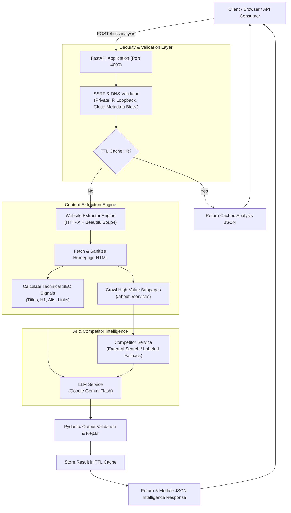

# SitePulse AI 🚀
## AI-Powered Website Intelligence & Business Growth Advisor

SitePulse AI is an enterprise-grade REST API built with **Python 3.11+**, **FastAPI**, **Google Gemini Flash**, **HTTPX**, and **BeautifulSoup4**. It accepts any public website URL, securely extracts its content, enforces multi-layered SSRF and DNS protections, and applies state-of-the-art Large Language Model (LLM) reasoning to produce structured, actionable business intelligence across five core modules:

1. **Competitor vs Brand Analysis**
2. **Top 5 Target Search Queries**
3. **SEO Improvement Recommendations**
4. **Top 5 Business Services**
5. **Target Audience Identification**

---

## 1. Project Introduction

In today's digital economy, understanding a company's market positioning, service capabilities, customer acquisition strategy, and SEO baseline requires deep website analysis. **SitePulse AI** transforms raw website HTML into an executive-ready business intelligence dossier in seconds.

Built with a production-first architecture, SitePulse AI avoids superficial mock data. It performs genuine website extraction, crawls high-value subpages (such as `/about` and `/services`), executes deterministic technical SEO diagnostics, validates external competitors, and feeds clean contextual signals into Google Gemini Flash for rigorous AI reasoning.

---

## 2. Real-World Problem

Digital agencies, venture capital analysts, B2B sales teams, SEO consultants, and enterprise advisors spend hours manually auditing prospective clients' websites:
- **Unclear Offerings:** Many websites bury their core value propositions in marketing fluff.
- **Competitor Blindspots:** Identifying real competitors requires extensive external searching; relying solely on generative AI can lead to hallucinations.
- **Keyword Research Friction:** Developing multi-platform search queries across Google, LinkedIn, X, and Instagram requires hours of cross-channel planning.
- **Technical SEO Gaps:** Basic issues like missing titles, duplicate headings, unoptimized metadata, and absent image alt text are often overlooked.
- **Audience Misalignment:** Sales and marketing teams struggle to segment ICPs (Ideal Customer Profiles) based on actual site content.

Manual research is slow, inconsistent, and costly to scale across hundreds of client audits.

---

## 3. Solution Overview

SitePulse AI provides an automated, programmatic solution accessible via a high-performance REST API and an interactive web dashboard:
- **Automated Content Ingestion:** Fetches target web pages with strict redirect and size guardrails.
- **Evidence-Based Extraction:** Pulls titles, meta tags, H1–H3 headings, navigation labels, contact details (emails, phone numbers), social profiles, and body text.
- **Deep Same-Domain Crawling:** Discovers and summarizes up to 2 high-value subpages to enrich business context.
- **Deterministic SEO Scoring:** Evaluates title/meta lengths, heading duplication, and image accessibility directly from parsed HTML.
- **AI Intelligence Synthesis:** Prompts Google Gemini Flash using structured JSON mode to generate verified insights without fabrication.
- **Data Provenance Distinction:** Strictly segregates extracted facts, reasonable AI inferences, external search-verified competitors, and strategic recommendations.

---

## 4. Key Features

- **5-Module Business Intelligence:** Full coverage of brand positioning, competitors, target queries, SEO health, services, and audience segmentation.
- **Strict SSRF & Private IP Protection:** Disallows loopback addresses, private subnets (RFC 1918), link-local addresses, and cloud metadata endpoints (AWS, GCP, Azure).
- **DNS Resolution Verification:** Resolves hostnames and verifies every IP entry before establishing HTTP connections.
- **Redirect Chain Security:** Follows redirects manually to inspect every intermediate hop for SSRF risks.
- **Competitor Provenance Tracking:** Supports external search verification (e.g., Tavily API) with fallback labels marking unverified AI suggestions.
- **Deterministic SEO Checks:** Identifies missing titles, meta descriptions, H1 headings, empty/duplicate headings, and image alt text health.
- **Pydantic Validation & Self-Healing:** Enforces strict Pydantic models for both incoming requests and outgoing LLM responses, repairing count discrepancies defensively.
- **In-Memory TTL Caching:** Prevents redundant LLM and scraping requests within a configurable time window (default: 3600s).
- **Interactive Web Dashboard:** Includes a clean UI at `/dashboard` for rapid testing and visual audits.

---

## 5. Technology Stack

| Layer | Component | Version / Library | Purpose |
|---|---|---|---|
| **API Framework** | FastAPI | `^0.110.0` | Asynchronous high-performance REST API |
| **ASGI Server** | Uvicorn | `^0.28.0` | Production ASGI web server |
| **Data Validation** | Pydantic & Pydantic-Settings | `^2.7.0` | Request validation, schema enforcement, settings |
| **HTTP Client** | HTTPX | `^0.27.0` | Asynchronous HTTP requests with redirect inspection |
| **HTML Parsing** | BeautifulSoup4 | `^4.12.0` | DOM parsing, tag stripping, entity extraction |
| **AI / LLM SDK** | Google GenAI SDK | `google-genai` / `google-generativeai` | Structured LLM reasoning with Gemini Flash |
| **Configuration** | python-dotenv | `^1.0.0` | Twelve-factor application configuration |
| **Testing** | Pytest & TestClient | `^8.0.0` | Comprehensive unit and integration test suite |

---

## 6. Architecture & Workflow



---

## 7. Project Structure

```
ai-link-analysis/
│
├── app/
│   ├── __init__.py
│   ├── main.py                  # FastAPI application, endpoints, exception handlers & lifespan
│   ├── config.py                # Environment configuration & pydantic settings
│   ├── schemas.py               # Complete Pydantic request/response models & validators
│   │
│   ├── services/
│   │   ├── __init__.py
│   │   ├── website_extractor.py # Safe HTTPX fetching, BS4 cleaning, subpage crawling & SEO signals
│   │   ├── llm_service.py       # Google Gemini Flash integration, prompt engineering & repair logic
│   │   ├── analysis_service.py  # Master orchestrator & in-memory TTL caching
│   │   └── competitor_service.py# External search lookup & labeled fallback profiles
│   │
│   ├── utils/
│   │   ├── __init__.py
│   │   └── validators.py        # SSRF protection, IP filtering, and DNS resolution verification
│   │
│   └── templates/
│       └── index.html           # Interactive visual web dashboard for browser access
│
├── tests/
│   ├── __init__.py
│   └── test_link_analysis.py    # 12 automated pytest unit and integration tests
│
├── .env                         # Local environment variables (not committed)
├── .env.example                 # Example environment template
├── .gitignore                   # Git exclusions
├── requirements.txt             # Locked project dependencies
├── README.md                    # Comprehensive documentation
└── Procfile                     # Deployment process definition (Render / Heroku)
```

---

## 8. Installation Instructions

### Prerequisites
- Python 3.10, 3.11, or 3.12
- Active Google Gemini API key ([Free via Google AI Studio](https://aistudio.google.com/))

### Step-by-Step Setup
1. **Clone the repository:**
   ```bash
   git clone https://github.com/your-username/sitepulse-ai.git
   cd sitepulse-ai
   ```

2. **Create and activate a virtual environment:**
   ```bash
   # Windows (PowerShell)
   python -m venv venv
   .\venv\Scripts\Activate.ps1

   # Linux / macOS
   python3 -m venv venv
   source venv/bin/activate
   ```

3. **Install dependencies:**
   ```bash
   pip install --upgrade pip
   pip install -r requirements.txt
   ```

---

## 9. Environment Setup

Copy `.env.example` to create your local `.env` file:
```bash
cp .env.example .env
```

Configure the following variables in `.env`:
```env
# Google Gemini API Key (Required)
GEMINI_API_KEY=your_actual_gemini_api_key_here

# Supported Gemini Model (Default: gemini-3.5-flash)
GEMINI_MODEL=gemini-3.5-flash

# Network & Server Settings
HOST=0.0.0.0
PORT=4000
ENVIRONMENT=development

# Scraping Limits
REQUEST_TIMEOUT_SECONDS=15.0
MAX_CONTENT_LENGTH=5242880
MAX_REDIRECTS=5
MAX_SUBPAGES_TO_CRAWL=2
MAX_EXTRACTED_CHARS=25000

# TTL Cache Lifetime (in seconds; 3600 = 1 hour)
CACHE_TTL_SECONDS=3600

# Optional External Search Provider for Verified Competitors
TAVILY_API_KEY=
SEARCH_API_KEY=
```

---

## 10. API Endpoint Documentation

The API runs on port 4000 by default. Interactive documentation is available at:
- **Swagger UI:** [http://localhost:4000/docs](http://localhost:4000/docs)
- **ReDoc:** [http://localhost:4000/redoc](http://localhost:4000/redoc)
- **Interactive Web Dashboard:** [http://localhost:4000/dashboard](http://localhost:4000/dashboard)

### Summary of Endpoints

| Method | Endpoint | Description |
|---|---|---|
| `GET` | `/` | Application metadata, status, version (or web dashboard if opened in browser) |
| `GET` | `/health` | Service health status, uptime, active AI model, and configuration flags |
| `GET` | `/dashboard` | Interactive visual dashboard for testing URLs |
| `POST` | `/link-analysis` | Primary intelligence endpoint for analyzing a website URL |

---

## 11. Sample Request

### cURL
```bash
curl -X POST "http://localhost:4000/link-analysis" \
     -H "Content-Type: application/json" \
     -d '{
       "url": "https://apexcloudsolutions.io"
     }'
```

### Python (HTTPX)
```python
import httpx

response = httpx.post(
    "http://localhost:4000/link-analysis",
    json={"url": "https://apexcloudsolutions.io"},
    timeout=30.0,
)
print(response.json())
```

---

## 12. Sample Response

```json
{
  "success": true,
  "website": "https://apexcloudsolutions.io",
  "brand": {
    "name": "Apex Cloud Solutions",
    "category": "Cloud Computing & DevOps Consulting",
    "summary": "Enterprise multi-cloud consulting, Kubernetes deployments, and automated CI/CD infrastructure services."
  },
  "analysis": {
    "competitor_analysis": {
      "brand_overview": {
        "name": "Apex Cloud Solutions",
        "business_overview": "Enterprise cloud consultancy specializing in managed Kubernetes, DevSecOps pipelines, and cloud migration.",
        "main_category": "Cloud Consulting & Infrastructure",
        "products_and_services": [
          "Managed Kubernetes Infrastructure",
          "Automated CI/CD DevOps Pipelines",
          "Cloud Security & Compliance Audits",
          "24/7 SRE Cloud Monitoring",
          "Legacy Migration & Microservices Modernization"
        ],
        "target_market": "High-growth tech companies and mid-market enterprises across North America",
        "competitive_advantages": [
          "99.99% SLA-backed uptime guarantee",
          "Multi-cloud expertise across AWS, GCP, and Azure",
          "Zero-downtime legacy migration methodology"
        ],
        "market_positioning": "Premium boutique cloud-native engineering partner",
        "improvement_opportunities": [
          "Publish transparent self-service pricing tiers",
          "Introduce a self-guided cloud cost calculator"
        ]
      },
      "competitors": [
        {
          "name": "Mission Cloud",
          "website_url": "https://www.missioncloud.com",
          "category": "AWS Premier Consulting Partner",
          "main_services": ["Managed Cloud Services", "AWS Migration"],
          "strengths": ["Deep AWS specialization", "Extensive enterprise case studies"],
          "weaknesses": ["Limited multi-cloud support outside AWS ecosystem"],
          "comparison": "Apex provides true multi-cloud agility across AWS, Azure, and GCP, whereas Mission is AWS-focused.",
          "evidence_or_source": "AI-generated estimation based on industry domain; unverified by external search API.",
          "verification_status": "ai_generated_unverified",
          "is_verified": false
        },
        {
          "name": "Contino",
          "website_url": "https://www.contino.io",
          "category": "Enterprise DevOps Transformation",
          "main_services": ["DevOps Transformation", "Cloud Platform Engineering"],
          "strengths": ["Strong enterprise advisory presence", "Cognizant backing"],
          "weaknesses": ["Higher consulting fees for mid-market clients"],
          "comparison": "Apex offers higher engineering velocity with dedicated senior architects.",
          "evidence_or_source": "AI-generated estimation based on industry domain; unverified by external search API.",
          "verification_status": "ai_generated_unverified",
          "is_verified": false
        },
        {
          "name": "Caylent",
          "website_url": "https://caylent.com",
          "category": "Cloud Native Engineering",
          "main_services": ["Kubernetes Consulting", "Cloud Native Modernization"],
          "strengths": ["Strong Kubernetes brand authority"],
          "weaknesses": ["Extended onboarding lead times"],
          "comparison": "Apex provides immediate 24/7 SRE support integration.",
          "evidence_or_source": "AI-generated estimation based on industry domain; unverified by external search API.",
          "verification_status": "ai_generated_unverified",
          "is_verified": false
        }
      ],
      "strengths": [
        "True multi-cloud neutrality (AWS, GCP, Azure)",
        "Integrated 24/7 proactive SRE support included"
      ],
      "opportunities": [
        "Capture underserved FinTech and HealthTech sectors needing strict compliance posture"
      ]
    },
    "target_search_queries": [
      {
        "query": "enterprise managed kubernetes multi cloud",
        "recommended_platforms": ["Google", "LinkedIn"],
        "search_intent": "Commercial",
        "business_relevance": "Drives high-intent inbound inquiries from VP Engineering seeking cluster management",
        "target_audience": "VP of Engineering and Cloud Architects",
        "source_type": "AI-generated query recommendation (non-benchmark)"
      },
      {
        "query": "#DevOpsTransformation #KubernetesDeployment",
        "recommended_platforms": ["LinkedIn", "X"],
        "search_intent": "Informational",
        "business_relevance": "Builds organic visibility among tech leaders evaluating CI/CD modernization",
        "target_audience": "DevOps Engineers and Technical Founders",
        "source_type": "AI-generated query recommendation (non-benchmark)"
      },
      {
        "query": "zero downtime cloud migration services",
        "recommended_platforms": ["Google"],
        "search_intent": "Transactional",
        "business_relevance": "Targets businesses urgently seeking legacy modernization without risk",
        "target_audience": "Enterprise CIOs and IT Directors",
        "source_type": "AI-generated query recommendation (non-benchmark)"
      },
      {
        "query": "SOC2 compliant cloud architecture consulting",
        "recommended_platforms": ["Google", "LinkedIn"],
        "search_intent": "Commercial",
        "business_relevance": "Captures growth-stage startups preparing for security audits",
        "target_audience": "Startup Founders and Security Leads",
        "source_type": "AI-generated query recommendation (non-benchmark)"
      },
      {
        "query": "24/7 dedicated SRE incident response team",
        "recommended_platforms": ["Google", "LinkedIn"],
        "search_intent": "Transactional",
        "business_relevance": "Attracts companies experiencing unacceptable downtime or MTTR delays",
        "target_audience": "Operations Managers and CTOs",
        "source_type": "AI-generated query recommendation (non-benchmark)"
      }
    ],
    "seo_improvements": {
      "primary_keyword": "enterprise cloud architecture consulting",
      "secondary_keywords": [
        "managed kubernetes infrastructure",
        "automated ci cd pipelines",
        "cloud security compliance audit"
      ],
      "long_tail_keywords": [
        "how to migrate legacy monolithic architecture to kubernetes microservices",
        "multi cloud kubernetes deployment aws azure gcp consulting"
      ],
      "existing_title": "Apex Cloud Solutions - Enterprise Cloud & DevOps Services",
      "recommended_title": "Apex Cloud Solutions | Enterprise Cloud & Kubernetes DevOps",
      "title_improvement_reason": "Optimizes length to 58 characters and shifts highest-intent keyword closer to the front.",
      "existing_meta_description": "Apex Cloud Solutions delivers world-class multi-cloud consulting, Kubernetes deployment, and automated DevOps infrastructure for modern high-growth enterprises.",
      "meta_description": "Accelerate multi-cloud velocity with Apex Cloud Solutions: Managed Kubernetes, automated CI/CD pipelines, and 24/7 SRE monitoring. Request your consultation.",
      "relevant_keywords": ["enterprise cloud", "kubernetes consulting", "devops automation"],
      "supporting_content": [
        {
          "content_type": "Service Landing Page",
          "topic": "Managed Multi-Cloud Kubernetes (EKS, GKE, AKS)",
          "target_keyword": "managed kubernetes services",
          "purpose": "Capture organic transactional searches from engineers evaluating managed k8s."
        },
        {
          "content_type": "Industry Page",
          "topic": "Cloud Compliance & Security for HealthTech (HIPAA) & FinTech (SOC2)",
          "target_keyword": "hipaa compliant cloud architecture",
          "purpose": "Establish sector authority in regulated enterprise markets."
        },
        {
          "content_type": "Blog Topic",
          "topic": "The Executive Guide to Zero-Downtime Monolith to Microservices Migration",
          "target_keyword": "legacy migration microservices",
          "purpose": "Top-of-funnel lead generation targeting engineering executives."
        }
      ],
      "seo_observations": [
        "Page title is present and well-structured.",
        "Primary H1 heading clearly articulates the core value proposition.",
        "1 out of 2 images lacks descriptive alt text."
      ]
    },
    "top_services": [
      {
        "service_name": "Managed Kubernetes Infrastructure",
        "description": "Deploy and maintain production-ready Kubernetes clusters across AWS, GCP, and Azure with 99.99% uptime SLAs.",
        "target_industry": "SaaS, FinTech, E-Commerce",
        "target_customer": "VP of Engineering, DevOps Leads",
        "main_benefit": "Zero cluster maintenance overhead with guaranteed enterprise reliability",
        "source_evidence": "Extracted from H2 tag: 'Managed Kubernetes Infrastructure'",
        "identification_type": "extracted"
      },
      {
        "service_name": "Automated CI/CD DevOps Pipelines",
        "description": "Eliminate release bottlenecks with end-to-end automated pipelines, GitOps workflows, and continuous security scanning.",
        "target_industry": "Software & Technology",
        "target_customer": "Lead Developers, Engineering Managers",
        "main_benefit": "Reduces release cycle time from weeks to minutes",
        "source_evidence": "Extracted from H2 tag: 'Automated CI/CD DevOps Pipelines'",
        "identification_type": "extracted"
      },
      {
        "service_name": "Cloud Security & Compliance Audits",
        "description": "Ensure SOC2, HIPAA, and ISO27001 readiness with comprehensive cloud posture assessments and automated remediation.",
        "target_industry": "Healthcare, Financial Services, Enterprise B2B",
        "target_customer": "Chief Information Security Officers (CISOs), Compliance Directors",
        "main_benefit": "Pass security compliance audits without hiring a dedicated security team",
        "source_evidence": "Extracted from H2 tag: 'Cloud Security & Compliance Audits'",
        "identification_type": "extracted"
      },
      {
        "service_name": "24/7 SRE Cloud Monitoring & Incident Response",
        "description": "Proactive observability, APM metrics, and immediate MTTR resolution for mission-critical enterprise systems.",
        "target_industry": "High-transaction digital platforms",
        "target_customer": "CTOs, Operations Directors",
        "main_benefit": "Prevents costly downtime with round-the-clock proactive remediation",
        "source_evidence": "Extracted from H2 tag: '24/7 SRE Cloud Monitoring & Incident Response'",
        "identification_type": "extracted"
      },
      {
        "service_name": "Legacy Migration & Microservices Modernization",
        "description": "Migrate monolithic architectures to cloud-native microservices seamlessly without downtime.",
        "target_industry": "Traditional Enterprises, Retail, Logistics",
        "target_customer": "Enterprise Architects, CIOs",
        "main_benefit": "Unlocks scalability and eliminates legacy technical debt without disruption",
        "source_evidence": "Extracted from H2 tag: 'Legacy Migration & Microservices Modernization'",
        "identification_type": "extracted"
      }
    ],
    "target_audience": {
      "primary_audience": ["Enterprise CTOs", "VPs of Engineering", "Cloud Infrastructure Directors"],
      "secondary_audience": ["Technical Founders of Funded Startups", "DevOps Team Leads"],
      "industries": ["B2B SaaS", "FinTech", "HealthTech", "E-Commerce"],
      "business_types": ["Growth-Stage Startups (Series A–C)", "Mid-Market Enterprises"],
      "customer_profiles": ["Companies scaling infrastructure rapidly and encountering release bottlenecks or downtime risks"],
      "geographical_focus": ["North America", "Western Europe"],
      "customer_needs": ["Enterprise-grade cloud reliability without inflating internal engineering headcount"],
      "customer_challenges": ["Talent shortage for specialized Kubernetes engineers", "Unpredictable cloud infrastructure bills"],
      "potential_interests": ["GitOps", "Kubernetes", "DevSecOps", "Cloud Cost Optimization"],
      "marketing_segments": [
        {
          "audience_name": "Growth-Stage SaaS Engineering Executives",
          "business_type": "B2B SaaS",
          "industry": "Software",
          "main_requirements": ["High-velocity deployments", "SOC2 compliance automation", "99.99% uptime"],
          "problems_faced": ["In-house engineers overwhelmed by DevOps tasks instead of building product features"],
          "business_relevance": "Apex offloads cluster management and delivers automated CI/CD out of the box",
          "suggested_marketing_channel": "LinkedIn Executive Thought Leadership & Account-Based Marketing (ABM)",
          "segment_type": "primary",
          "is_inferred": true
        },
        {
          "audience_name": "Regulated FinTech & HealthTech Technical Leaders",
          "business_type": "FinTech / HealthTech",
          "industry": "Financial & Healthcare Technology",
          "main_requirements": ["HIPAA/PCI-DSS compliance", "Zero-downtime microservices"],
          "problems_faced": ["Navigating stringent compliance mandates on public cloud providers"],
          "business_relevance": "Apex provides certified compliance blueprints and automated audit controls",
          "suggested_marketing_channel": "Google Search Ads targeting high-intent commercial compliance queries",
          "segment_type": "secondary",
          "is_inferred": true
        }
      ]
    }
  },
  "metadata": {
    "analyzed_at": "2026-11-20T17:15:00.000000Z",
    "pages_analyzed": 1,
    "ai_model": "gemini-3.5-flash",
    "analysis_type": "AI-powered website analysis",
    "cached": false,
    "estimated_tokens": {
      "input_tokens": 1420,
      "output_tokens": 940,
      "total_tokens": 2360
    },
    "estimated_cost_usd": 0.000388,
    "execution_time_seconds": 1.34
  }
}
```

---

## 13. Error Handling

SitePulse AI provides clean, standardized JSON error responses with distinct HTTP status codes:

```json
{
  "success": false,
  "error": "Security violation: Hostname resolves to disallowed IP 127.0.0.1",
  "error_code": "SSRF_PROTECTION_VIOLATION",
  "detail": "The requested URL targets an internal, private, loopback, or cloud metadata network destination."
}
```

### HTTP Status Code Reference

| Status Code | Error Code | Trigger Condition |
|---|---|---|
| `400 Bad Request` | `SSRF_PROTECTION_VIOLATION` | Private IP, localhost, cloud metadata, or credentialed URL detected |
| `400 Bad Request` | `DNS_RESOLUTION_FAILED` | Hostname could not be resolved via DNS |
| `404 Not Found` | `WEBSITE_EXTRACTION_ERROR` | Target website returned HTTP 404 Not Found |
| `413 Payload Too Large` | `WEBSITE_EXTRACTION_ERROR` | Target HTML exceeded size limit (5 MB) |
| `415 Unsupported Media` | `WEBSITE_EXTRACTION_ERROR` | Content-Type is not `text/html` (e.g. PDF or binary) |
| `422 Unprocessable` | `INVALID_URL_FORMAT` | Malformed URL or non-HTTP/HTTPS scheme (e.g. `ftp://`) |
| `422 Unprocessable` | `WEBSITE_EXTRACTION_ERROR` | Target website returned completely empty content |
| `429 Too Many Requests` | `LLM_RATE_LIMIT_EXCEEDED` | Google Gemini API quota or rate limit exceeded |
| `500 Internal Error` | `LLM_CONFIGURATION_ERROR` | Missing or invalid `GEMINI_API_KEY` |
| `502 Bad Gateway` | `WEBSITE_EXTRACTION_ERROR` | Upstream connection timeout or network failure |
| `502 Bad Gateway` | `AI_ANALYSIS_FAILED` | Upstream LLM returned malformed JSON |

---

## 14. Testing Instructions

The automated test suite in `tests/test_link_analysis.py` covers 12 core scenarios:
1. Root endpoint metadata (`GET /`)
2. Health check endpoint (`GET /health`)
3. End-to-end link analysis flow with mocked services
4. Invalid URL format rejection
5. Unsupported schemes (`ftp://`, `file://`, `gopher://`)
6. SSRF and private IP protection (localhost, RFC 1918, 169.254.169.254)
7. Website 404 handling
8. Website connection failure & timeout handling
9. Empty website content detection
10. Full Pydantic schema validation
11. Gemini rate-limit error handling (HTTP 429)
12. Gemini configuration error handling (HTTP 500)

### Running Tests
```bash
pytest -v
```

### Test Output Verification
```
tests/test_link_analysis.py::test_root_endpoint PASSED                   [  8%]
tests/test_link_analysis.py::test_health_endpoint PASSED                 [ 16%]
tests/test_link_analysis.py::test_valid_url_analysis PASSED              [ 25%]
tests/test_link_analysis.py::test_invalid_url_format PASSED              [ 33%]
tests/test_link_analysis.py::test_unsupported_scheme PASSED              [ 41%]
tests/test_link_analysis.py::test_ssrf_and_private_ip_rejection PASSED   [ 50%]
tests/test_link_analysis.py::test_website_unavailable_404 PASSED         [ 58%]
tests/test_link_analysis.py::test_website_unavailable_connection_error PASSED [ 66%]
tests/test_link_analysis.py::test_empty_website_content PASSED           [ 75%]
tests/test_link_analysis.py::test_pydantic_schema_validation PASSED      [ 83%]
tests/test_link_analysis.py::test_gemini_rate_limit_handling PASSED      [ 91%]
tests/test_link_analysis.py::test_gemini_config_error_handling PASSED    [100%]

============================= 12 passed in 10.92s =============================
```

---

## 15. LLM Model Comparison

A research-based comparison of lightweight foundation models for web intelligence extraction:

| Feature / Metric | **Google Gemini Flash (3.5 / 2.5)** | **OpenAI GPT-4o mini** | **Anthropic Claude 3.5 Haiku** |
|---|---|---|---|
| **Input Price (per 1M tokens)** | **\$0.075** (≤ 128k context) | \$0.150 | \$0.800 |
| **Output Price (per 1M tokens)** | **\$0.300** (≤ 128k context) | \$0.600 | \$4.000 |
| **Context Window** | **1,000,000 tokens** | 128,000 tokens | 200,000 tokens |
| **Structured Output Mode** | Native `application/json` mode | Strict JSON schema mode | Tool-use / system prompt prefill |
| **Time to First Token (TTFT)** | Fast (~250–450 ms) | Fast (~300–500 ms) | Fast (~300–600 ms) |
| **Large HTML Understanding** | Exceptional (handles large DOM dumps) | Strong on clean text | Strong reasoning, higher price |
| **Free Tier / Development Access** | Generous free tier via Google AI Studio | Pay-as-you-go only | Pay-as-you-go only |

*Note: Pricing and specifications are derived from official provider documentation.*

---

## 16. Model Recommendation

**Recommended Model:** `gemini-3.5-flash`

### Why Google Gemini Flash is Ideal for SitePulse AI:
1. **Unbeatable Cost Efficiency:** Gemini Flash is **50% more affordable** than GPT-4o mini and **over 10x cheaper** than Claude 3.5 Haiku. A complete 5-module analysis costs approximately **\$0.00038 USD** per website.
2. **Massive Context Window (1M Tokens):** Crawling multiple subpages creates substantial textual excerpts. Gemini Flash processes these without aggressive truncation or loss of nuance.
3. **Native JSON Output:** Gemini's `application/json` response mode guarantees syntactically valid JSON structures matching Pydantic schemas.
4. **Configurable Model Agility:** The application supports dynamic model switching via `GEMINI_MODEL` in `.env`.

---

## 17. Cost and Performance Optimization

1. **DOM Cleaning & Tag Stripping:** Removes scripts, styles, SVG paths, iframes, and cookie banner boilerplate before tokenization, reducing token payload by **up to 75%**.
2. **Character & Token Budgets:** Enforces a maximum character budget (`MAX_EXTRACTED_CHARS=25000`) to cap input token costs predictably.
3. **Single LLM Orchestration:** Consolidates all 5 intelligence modules into a single, cohesive prompt call, eliminating multiple round-trip latencies.
4. **In-Memory TTL Caching:** Repeated analysis requests for the same domain are served instantly from memory without re-extracting HTML or calling the LLM.
5. **Selective Subpage Crawling:** Crawls a maximum of 2 high-value subpages (`MAX_SUBPAGES_TO_CRAWL=2`), focusing strictly on commercial and about content.

---

## 18. Deployment Instructions (Render & Cloud PaaS)

SitePulse AI is ready for deployment on **Render**, **Railway**, **Fly.io**, or any standard container host.

### Deploying on Render

1. **Push your code to a Git repository:**
   ```bash
   git init
   git add .
   git commit -m "SitePulse AI production release"
   git branch -M main
   git remote add origin https://github.com/your-username/sitepulse-ai.git
   git push -u origin main
   ```

2. **Create a Web Service on Render:**
   - Go to [Render Dashboard](https://dashboard.render.com/) and click **New +** -> **Web Service**.
   - Connect your GitHub repository.

3. **Configure Service Settings:**
   - **Environment:** `Python 3`
   - **Build Command:** `pip install -r requirements.txt`
   - **Start Command:** `uvicorn app.main:app --host 0.0.0.0 --port $PORT`
   - *(The included `Procfile` is automatically detected by Render).*

4. **Set Environment Variables in Render:**
   - `GEMINI_API_KEY`: Your Google AI Studio API key
   - `GEMINI_MODEL`: `gemini-3.5-flash`
   - `ENVIRONMENT`: `production`

5. **Set Health Check Path:**
   - Set the health check path to `/health`.

---

## 19. Limitations and Future Improvements

1. **Client-Rendered Single-Page Apps (SPAs):** Websites that render entirely via client-side JavaScript (e.g. CSR React/Vue apps with empty `<div id="root">`) provide limited content to HTTPX. A future enhancement will introduce an optional headless browser fallback (Playwright).
2. **Third-Party Keyword Research Data:** Search queries currently represent AI-recommended high-intent customer search terms. Future releases will integrate search volume and CPC metrics from providers like Semrush or DataForSEO.
3. **Distributed Multi-Node Caching:** The current caching layer utilizes an in-memory TTL dictionary. Multi-replica cluster deployments will benefit from a Redis cache backend.
4. **PDF & Document Parsing:** Future updates will enable extraction of downloadable company brochures and service whitepapers linked on websites.

---

## License

MIT License. Designed and built for developers, agencies, and growth teams.
