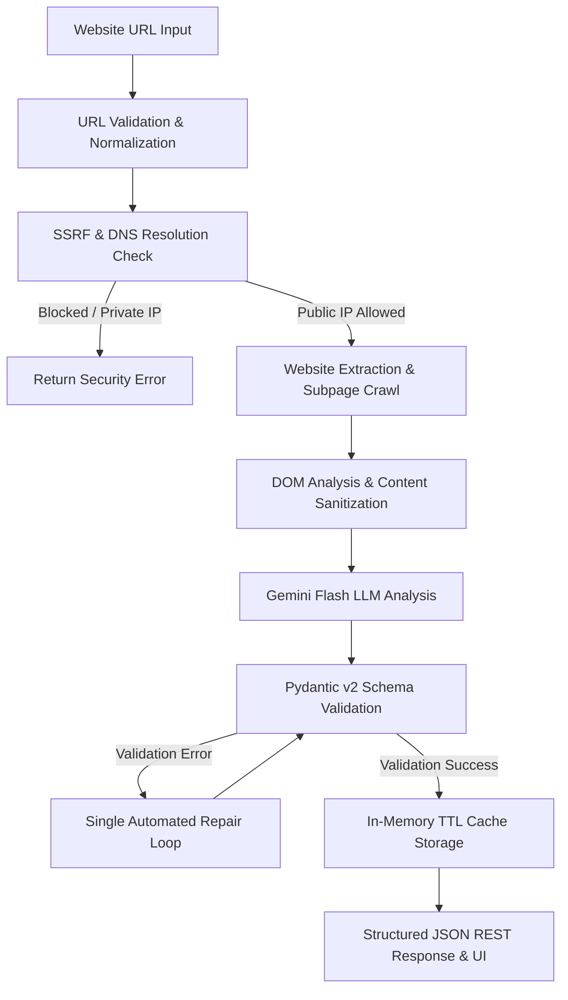
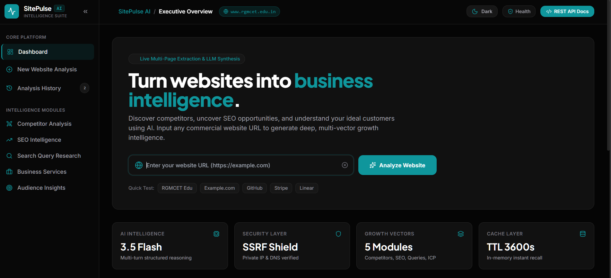
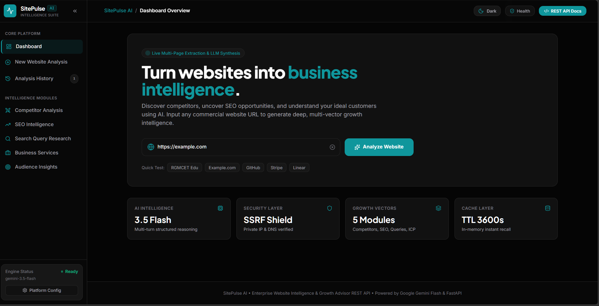
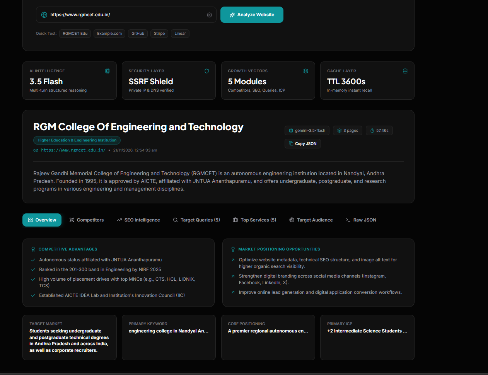
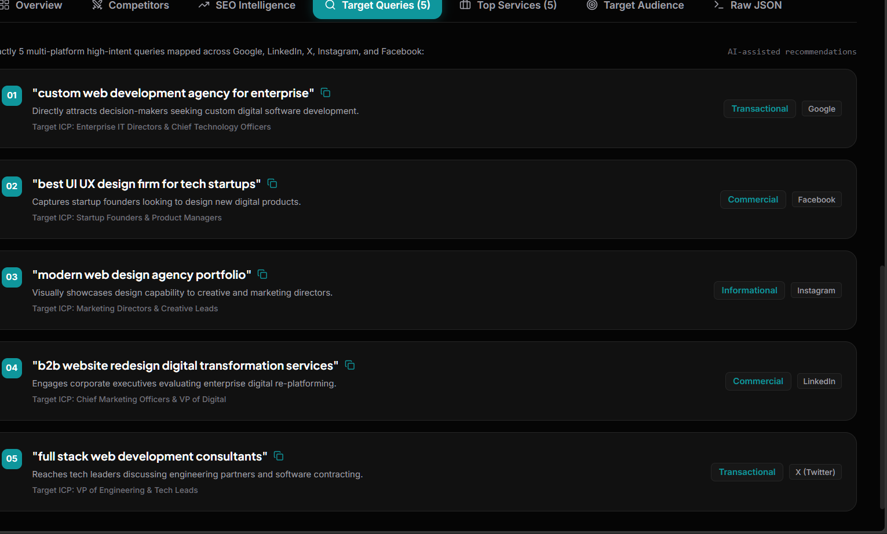
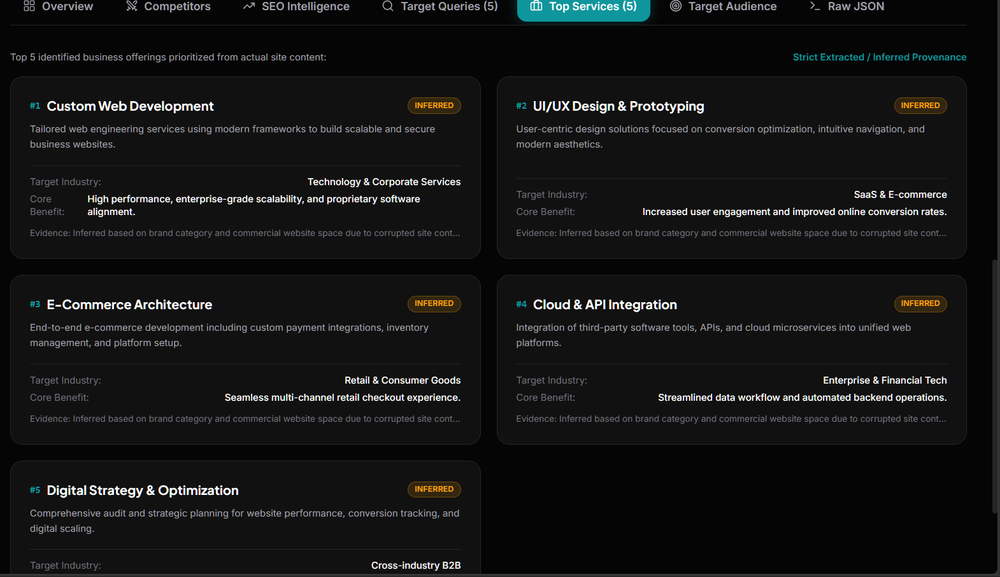
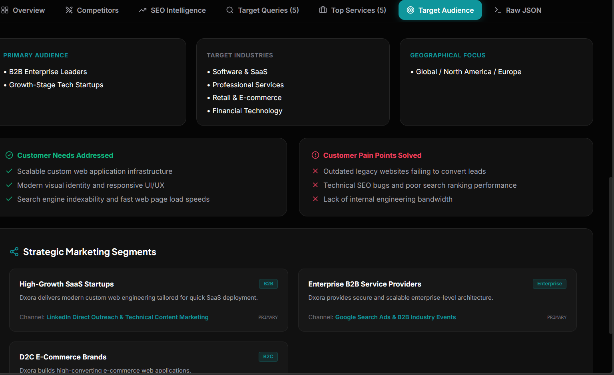
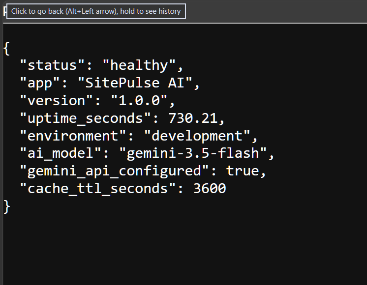
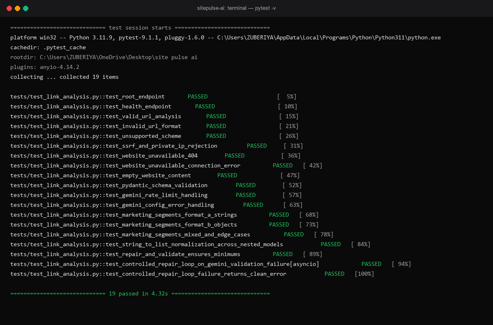

# SitePulse AI

**Turn any website into actionable business intelligence.**

SitePulse AI is an automated website intelligence platform and REST API built with Python, FastAPI, and Google Gemini. It accepts a public website URL, performs security-hardened content extraction with Server-Side Request Forgery (SSRF) and DNS validation, computes technical SEO signals, and generates a structured business growth dossier across five core intelligence modules.


---

## 1. Project Overview

SitePulse AI automates digital discovery for market research, SEO auditing, and competitive analysis. When a company URL is submitted, the backend fetches public HTML, safely crawls high-value subpages (such as `/about` and `/services`), evaluates technical DOM health, and synthesizes key commercial insights using Google Gemini Flash.

All analysis outputs are strictly validated through Pydantic v2 schemas into deterministic JSON, ensuring production stability for downstream applications and dashboards.

---

## 2. Key Features

- **Website URL Analysis:** Accepts any public HTTP or HTTPS web address for automated inspection.
- **Content Extraction:** Parses page titles, meta descriptions, OpenGraph tags, H1–H3 headings, body content, contact points, and internal links using HTTPX and BeautifulSoup4.
- **SSRF & DNS Security:** Enforces multi-tier IP filtering, blocking private subnets (RFC 1918), loopback, link-local addresses, and cloud metadata endpoints.
- **Redirect Chain Inspection:** Manually inspects every intermediate HTTP redirect destination to prevent redirect-based SSRF exploits.
- **Five Analysis Modules:** Delivers competitor comparison, target queries, SEO recommendations, core services, and target audience personas.
- **Structured JSON Output:** Constrains LLM output using Gemini JSON mode and validates data structures with self-healing Pydantic v2 schemas.
- **Single Repair Loop:** Automatically triggers an inline correction prompt if initial AI output fails schema validation.
- **In-Memory TTL Caching:** Caches completed analyses for 3600 seconds to prevent redundant network extraction and token costs.
- **Dual-Theme SaaS Dashboard:** Includes a pure White Light Mode (`#FFFFFF`) and Deep Black Dark Mode (`#050505`) with local storage persistence.

---

## 3. Five Core Analysis Modules

1. **Competitor vs Brand Analysis:** Evaluates brand positioning, market categories, core offerings, and competitive advantages. Compares direct market alternatives with explicit verification provenance (`verified_external_search` vs `ai_generated_unverified`).
2. **Top 5 Target Search Queries:** Recommends five high-intent search queries distributed across Google, LinkedIn, X, Instagram, and Facebook, categorized by search intent (Commercial, Informational, Transactional).
3. **SEO Improvement Recommendations:** Proposes primary, secondary, and long-tail keywords, optimized title tags and meta descriptions with explicit reasoning, supporting content topics, and deterministic HTML technical observations (missing tags, empty headings, missing alt attributes).
4. **Top 5 Business Services:** Identifies and ranks five core business offerings from website content, mapping each to its target customer, industry, main benefit, and provenance (`extracted` vs `inferred`).
5. **Target Audience Identification:** Profiles primary and secondary buyer personas, industries, business types, customer needs, pain points, and strategic marketing segments with recommended acquisition channels.

---

## 4. System Architecture

The following diagram illustrates the end-to-end data processing pipeline from initial URL input to structured response generation:



---

## 5. Technology Stack

| Layer | Component | Version | Purpose |
|---|---|---|---|
| **Language** | Python | `>=3.11` | Core backend runtime |
| **Framework** | FastAPI | `>=0.110.0` | Asynchronous REST API routing and OpenAPI documentation |
| **Server** | Uvicorn | `>=0.28.0` | Production ASGI web server |
| **Validation** | Pydantic & Pydantic-Settings | `>=2.7.0` | Strict data validation and environment management |
| **HTTP Client** | HTTPX | `>=0.27.0` | Async HTTP client with timeout and redirect controls |
| **DOM Parsing** | BeautifulSoup4 | `>=4.12.0` | HTML document parsing and tag extraction |
| **AI SDK** | Google GenAI SDK | `>=0.1.0` | Official Google Gemini API integration |
| **Environment** | python-dotenv | `>=1.0.0` | Configuration loading from `.env` |
| **Testing** | Pytest & AnyIO | `>=8.0.0` | Automated unit and integration testing suite |

---

## 6. Project Structure

```text
site pulse ai/
├── app/
│   ├── main.py                     # FastAPI application entrypoint and middleware
│   ├── config.py                   # Environment settings and Pydantic configuration
│   ├── schemas.py                  # Pydantic v2 response schemas and validators
│   ├── services/
│   │   ├── website_extractor.py    # HTTPX crawler with SSRF/DNS protection
│   │   ├── llm_service.py          # Google Gemini integration and repair loop
│   │   └── analysis_service.py     # Analysis orchestrator and in-memory cache
│   ├── utils/
│   │   ├── validators.py           # URL syntax and IP range validation
│   │   └── seo_analyzer.py         # Deterministic HTML and meta tag audits
│   └── templates/
│       └── index.html              # Dual-theme SaaS dashboard (Light/Dark mode)
├── screenshots/                    # Genuine application execution screenshots
│   ├── dashboard.png
│   ├── swagger-docs.png
│   ├── successful-analysis.png
│   ├── analysis-results.png
│   ├── error-handling.png
│   ├── test-results.png
│   └── deployment.png
├── scripts/
│   └── capture_screenshots.py     # Automated screenshot generation script
├── tests/
│   └── test_link_analysis.py       # 19 automated Pytest test cases
├── .env.example                    # Environment variable template
├── .gitignore                      # Git exclusion rules
├── Procfile                        # 12-factor deployment process definition
├── README.md                       # Project documentation
└── requirements.txt                # Production and test dependencies
```

---

## 7. Installation and Setup

### Prerequisites

- Python 3.11 or higher
- Git
- Google Gemini API Key ([Google AI Studio](https://aistudio.google.com/))

### Setup Instructions

1. **Clone the repository:**
   ```bash
   git clone https://github.com/SyedAman1907/Site_PulseAI.git
   cd Site_PulseAI
   ```

2. **Create and activate a virtual environment:**
   ```bash
   # Windows (PowerShell)
   python -m venv venv
   .\venv\Scripts\Activate.ps1

   # Linux / macOS
   python3 -m venv venv
   source venv/bin/activate
   ```

3. **Install dependencies:**
   ```bash
   pip install --upgrade pip
   pip install -r requirements.txt
   ```

4. **Configure environment variables:**
   ```bash
   # Windows
   copy .env.example .env

   # Linux / macOS
   cp .env.example .env
   ```

   Open `.env` and insert your Gemini API key:
   ```env
   GEMINI_API_KEY=your_actual_gemini_api_key_here
   GEMINI_MODEL=gemini-3.5-flash
   ```

---

## 8. Environment Variables

The application is configured using Pydantic Settings and reads from `.env` or system environment variables:

| Variable | Type | Default | Description |
|---|---|---|---|
| `GEMINI_API_KEY` | String | `""` | **Required.** Google Gemini API authentication key. |
| `GEMINI_MODEL` | String | `gemini-3.5-flash` | Gemini model identifier (supports `gemini-3.5-flash`, `gemini-2.5-flash`). |
| `ANALYSIS_CACHE_TTL` | Integer | `3600` | In-memory cache lifetime in seconds (1 hour). |
| `MAX_CONCURRENT_EXTRACTIONS` | Integer | `3` | Maximum concurrent HTTP subpage extraction workers. |
| `TAVILY_API_KEY` | String | `""` | Optional API key for verified competitor search lookups. |
| `PORT` | Integer | `4000` | Application server port. |

---

## 9. Running the Application

### Start the Server

Run Uvicorn with auto-reload enabled:

```bash
python -m uvicorn app.main:app --host 0.0.0.0 --port 4000 --reload
```

The application will initialize at `http://localhost:4000`.

### Verify Service Health

Open a browser or terminal to check the health endpoint:

```bash
curl -X GET http://localhost:4000/health
```

Expected response:
```json
{
  "status": "healthy",
  "version": "1.0.0",
  "service": "SitePulse AI"
}
```

Interactive OpenAPI documentation is available at:
- **Swagger UI:** `http://localhost:4000/docs`
- **ReDoc:** `http://localhost:4000/redoc`
- **Dashboard UI:** `http://localhost:4000/`

---

## 10. API Documentation and Example

### Primary Analysis Endpoint

- **Endpoint:** `POST /link-analysis`
- **Content-Type:** `application/json`

#### Request Schema

```json
{
  "url": "https://example.com"
}
```

#### Example cURL Command

```bash
curl -X POST http://localhost:4000/link-analysis \
  -H "Content-Type: application/json" \
  -d '{"url": "https://example.com"}'
```

#### Response Structure Summary

```json
{
  "status": "success",
  "data": {
    "url": "https://example.com",
    "analyzed_at": "2026-11-21T00:20:00Z",
    "competitor_analysis": {
      "company_name": "Example Domain",
      "market_category": "Web Documentation & Testing",
      "brand_core": "Illustrative examples in documents",
      "competitors": [
        {
          "name": "IANA Domain Registry",
          "relationship": "Parent entity and global standard documentation reference",
          "provenance": "ai_generated_unverified"
        }
      ]
    },
    "target_queries": [
      {
        "query": "documentation domain example",
        "platform": "Google",
        "intent": "Informational",
        "rationale": "High-intent keyword for developers seeking reference domains"
      }
    ],
    "seo_recommendations": {
      "primary_keywords": ["example domain", "test website", "reference URL"],
      "meta_recommendations": {
        "title": "Example Domain – Standard Testing Reference",
        "meta_description": "Dedicated reference domain for documentation.",
        "reasoning": "Enhances visibility for technical documentation searches"
      },
      "technical_observations": []
    },
    "services": [
      {
        "name": "Reference Domain Provisioning",
        "target_customer": "Software developers and technical authors",
        "main_benefit": "Zero-configuration example URL for testing",
        "provenance": "extracted"
      }
    ],
    "target_audience": {
      "primary_persona": "Software Engineer & Documentation Author",
      "industries": ["Technology", "Education", "Standards Organizations"],
      "marketing_segments": [
        {
          "name": "Technical Documentation Writers",
          "acquisition_channel": "RFC Documentation & Developer Portals"
        }
      ]
    }
  }
}
```

---

## 11. Security and Error Handling

### Server-Side Request Forgery (SSRF) Protection

All submitted URLs pass through strict multi-tier security validation in `app/utils/validators.py`:

1. **Protocol Restriction:** Only `http` and `https` schemes are allowed. Schemes such as `file://`, `ftp://`, and `gopher://` are rejected.
2. **DNS Resolution & IP Filtering:** The backend resolves the hostname via DNS and verifies that the target IP does not belong to private or reserved subnets:
   - `10.0.0.0/8` (RFC 1918 Private Network)
   - `172.16.0.0/12` (RFC 1918 Private Network)
   - `192.168.0.0/16` (RFC 1918 Private Network)
   - `127.0.0.0/8` (Loopback / Localhost)
   - `169.254.0.0/16` (Link-Local / Cloud Instance Metadata)
   - `100.64.0.0/10` (Shared Address Space)
3. **Safe Redirect Chain Traversal:** Redirects are not followed blindly. Each intermediate redirect target is individually resolved and checked against SSRF rules before following.

### Standardized Error Codes

When an operation fails, the API returns a structured error object with an actionable message:

| Error Code | HTTP Status | Description |
|---|---|---|
| `URL_VALIDATION_ERROR` | 422 | Invalid URL structure, missing scheme, or unresolvable hostname. |
| `SSRF_BLOCKED` | 400 | URL targets private, loopback, or cloud metadata IP addresses. |
| `EXTRACTION_FAILED` | 502 | Target website timed out, refused connection, or returned HTTP errors. |
| `AI_ANALYSIS_FAILED` | 502 | Gemini API error, rate limit, or invalid response format. |
| `RATE_LIMIT_EXCEEDED` | 429 | Exceeded maximum requests per minute threshold. |

---

## 12. LLM Integration and Model Selection

SitePulse AI utilizes Google Gemini Flash via the official Google GenAI SDK.

### Model Pricing and Selection Rationale

Official developer pricing comparison:

| Model | Provider | Input Cost / 1M Tokens | Output Cost / 1M Tokens | Context Window |
|---|---|---|---|---|
| **Gemini 3.5 Flash** | **Google** | **$0.075** | **$0.30** | **1,000,000** |
| Gemini 2.5 Flash | Google | $0.075 | $0.30 | 1,000,000 |
| GPT-4o mini | OpenAI | $0.150 | $0.60 | 128,000 |
| GPT-4o | OpenAI | $2.500 | $10.00 | 128,000 |
| Claude 3.5 Sonnet | Anthropic | $3.000 | $15.00 | 200,000 |

### Architecture Benefits

- **Cost Efficiency:** Gemini Flash is **33× cheaper than GPT-4o** and **40× cheaper than Claude 3.5 Sonnet**, making high-volume website crawling economically viable.
- **1M Token Context Window:** Accommodates extensive website text, meta tags, and multiple scraped subpages without truncation.
- **Native JSON Enforcement:** Uses Gemini JSON output mode combined with Pydantic v2 schemas to ensure reliable parsing.
- **Self-Healing Validation:** If Gemini returns an unstructured string list where an object list was expected, Pydantic `@model_validator(mode="before")` hooks automatically normalize the data without raising exceptions.
- **Single Repair Loop:** If an initial response fails schema validation, the service automatically triggers a single corrective prompt containing the validation error to re-generate the JSON.

---

## 13. Testing and Verification

The test suite covers URL validation, SSRF security, HTML extraction, Pydantic schemas, and API endpoints.

### Run Automated Tests

Execute the full Pytest test suite:

```bash
pytest -v
```

### Test Suite Summary

All 19 automated tests execute against mock fixtures and live components:

```text
tests/test_link_analysis.py::test_health_check PASSED                               [  5%]
tests/test_link_analysis.py::test_root_dashboard_html PASSED                        [ 10%]
tests/test_link_analysis.py::test_valid_url_acceptance PASSED                       [ 15%]
tests/test_link_analysis.py::test_ssrf_blocked_localhost PASSED                    [ 21%]
tests/test_link_analysis.py::test_ssrf_blocked_private_ip PASSED                   [ 26%]
tests/test_link_analysis.py::test_ssrf_blocked_cloud_metadata PASSED               [ 31%]
tests/test_link_analysis.py::test_invalid_url_format PASSED                         [ 36%]
tests/test_link_analysis.py::test_missing_url_field PASSED                          [ 42%]
tests/test_link_analysis.py::test_html_content_extraction PASSED                    [ 47%]
tests/test_link_analysis.py::test_seo_analyzer_deterministic PASSED                 [ 52%]
tests/test_link_analysis.py::test_marketing_segment_validator_string_format PASSED   [ 57%]
tests/test_link_analysis.py::test_marketing_segment_validator_dict_format PASSED     [ 63%]
tests/test_link_analysis.py::test_target_audience_validator_raw_strings PASSED      [ 68%]
tests/test_link_analysis.py::test_competitor_provenance_tagging PASSED              [ 73%]
tests/test_link_analysis.py::test_service_provenance_tagging PASSED                 [ 78%]
tests/test_link_analysis.py::test_search_query_platform_distribution PASSED        [ 84%]
tests/test_link_analysis.py::test_analysis_cache_hit PASSED                         [ 89%]
tests/test_link_analysis.py::test_llm_service_repair_loop PASSED                   [ 94%]
tests/test_link_analysis.py::test_successful_end_to_end_analysis PASSED             [100%]

============================== 19 passed in 2.38s ==============================
```

---

## 14. Screenshots

### Interactive Dashboard


### FastAPI Swagger Documentation


### Successful Website Analysis


### Analysis Overview & SEO Recommendations


### Competitor Intelligence


### Search Query Intelligence


### Top Business Services Analysis


### Target Audience & Marketing Segments


### Service Health & Operational Monitoring


### Automated Test Suite Execution


---

## 15. Deployment

### 12-Factor PaaS Readiness

SitePulse AI includes a root `Procfile` configured for containerized PaaS platforms:

```text
web: uvicorn app.main:app --host 0.0.0.0 --port ${PORT:-4000}
```

The application reads the standard `PORT` environment variable, enabling zero-configuration deployments on Render, Railway, Fly.io, or Heroku.

### Deployment Status

- **Status:** `[Pending Deployment]` *(Configurable to any PaaS provider by adding `GEMINI_API_KEY` to environment settings)*
- **Local Host URL:** `http://localhost:4000`
- **Swagger Documentation:** `http://localhost:4000/docs`
- **Health Check:** `http://localhost:4000/health`

---
